**How do SIFT, ORB, and BRISK compare in repeatability, localization error, and speed under viewpoint vs. illumination change?**

# Testing Different Feature Detectors
- SIFT (Scale-Invariant Feature Transform)
- ORB (Oriented FAST and Rotated BRIEF)
- BRISK (Binary Robust Invariant Scalable Keypoints)

We will be tracking a few metrics:
- Repeatability Rate
- Localization Error
- Keypoints Per Second
- Number of Matches (keypoint of transformed image has same descriptor as when it was in original image)
- Precision
- Recall

Across image sequences with viewpoint changes, and then across image sequences with illumination differences.

## Key Definitions
**Keypoint:** key points in an image, such as corners, edges, or blobs\
**Descriptor:** a unique signature for a keypoint (in feature detectors, descriptors are stored as an array of numbers); includes information on pixel intensities, edge directions, gradients; ideally, a good descriptor should remain invariant to transformations like rotation, scaling, changes in illumination/viewpoint\
**SIFT:** Scale-Invariant Feature Transform; developed in 1999, and specialices in scale and rotation changes (good at identifying same keypoints and descriptors even when you zoom in on an object or rotate the image)\
**ORB:** Oriented FAST and Rotated BRIEF; made in 2011, it specializes in speed, and the fact that it is open-source (faster because it uses integers and logical operations rather than float math). It is a combination of FAST (used for finding corners) and BRIEF (used to convert those points into binary data vectors for easy comparison)\
**BRISK:** Binary Robust Invariant Scalable Keypoints; it looks for keypoints by comparing the brightness of nearby pixels, and storing it as binary values (1 if a pixel is brighter, 0 if not). also uses FAST to find corners\
**Homography:** A 3x3 transformation matrix that maps an image onto another plane (basically the image viewed from a different perspective)\
**Repeatability Rate:** checking how many keypoints from the original image were detected in the transformed image
<ul style="margin-top: -10px; margin-bottom: 0px; padding-left: 20px;">
  <li style="margin-bottom: 2px;">Note: we only check the original image's project points onto image N, not the other way around</li>
</ul>

**Localization Error:** checking how far the keypoints in the transformed image were compared to their location in the original image

## Setup and Limitations
The dataset used was from HPatches Sequences (https://github.com/hpatches/hpatches-dataset/tree/master)

Each detector was allowed 1000 keypoints (for BRISK, the keypoints were trimmed to the top 1000 strongest keypoints). The pixel threshold was 3, and the ratio test value (for checking if the keypoints matched the descriptors) was 0.75. Each detector was run on an image three times, and the average time was taken for the kps (note that an intiial run was done for all three as the first run can often be slower to build cache; only the three after the first run were used for calculating average).

### Device Specifications
This experiment was run on an HP Envy x360
- CPU: AMD Ryzen 7 8840HS
    - Note that everything was run on the CPU, no GPU acceleration
- RAM: 16 GB
- OS: Windows 11 Home, version 25H2

Code was run while laptop was on battery (above 50%, low power mode). No other heavy background processes were open during the timed runs.

### Tech Stack
- Python 3.13.4
- OpenCV 4.14.0.94
    - Note: Using opencv-python 4.x as brisk moved to a different package after ver 5+
- NumPy 2.5.3
- Matplotlib 3.11.2
- Pandas 3.0.6
- Scipy 1.18.1
- tqdm 4.70.1

## Results
**Overall Findings**\
blablabla

### Detection
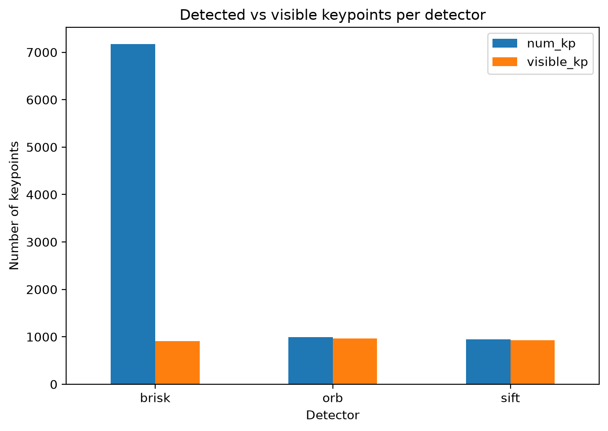

*caption*\
The visible keypoints count tends to be lower than the original number of generated keypoints. For BRISK, a set keypoint count couldn't be passed in so the original amount was very high, but got trimmed to 1000. However, for ORB and SIFT, some keypoints were lost after being translated as they were outside of the translated image, so the visible kp is slightly lower than the originally generated ones.

### Repeatability and Localization
To clarify the definition of repeatability, it is the number of keypoints from the original image that were also located in the transformed image. Note that this experiment uses a simplified definition of repeatability, as usually it is also tested by mapping the transformed keypoints back onto the original image./
Localization error is measured in pixels, and describes the distance the transformed keypoint is from the one in the original image.

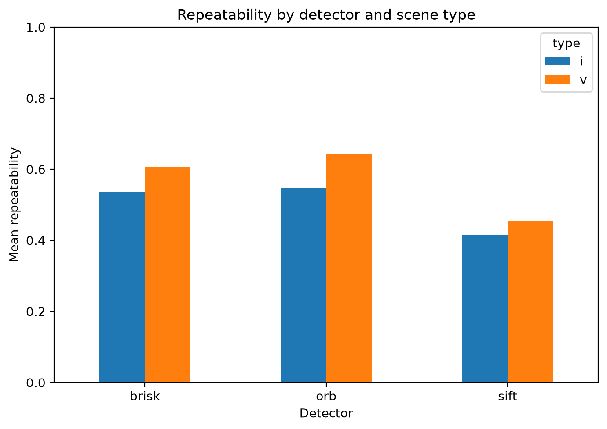

All three detectors tended to have a higher average repeatability when testing against viewpoint changes. ORB had the highest repeatability for both illumination and viewpoint changes, but no detector seemed to surpass 70% repeatability (note that this number is likely influenced by parts of the methodology and device specs). SIFT had the lowest mean repeatability for both viewpoint and illumination changes.

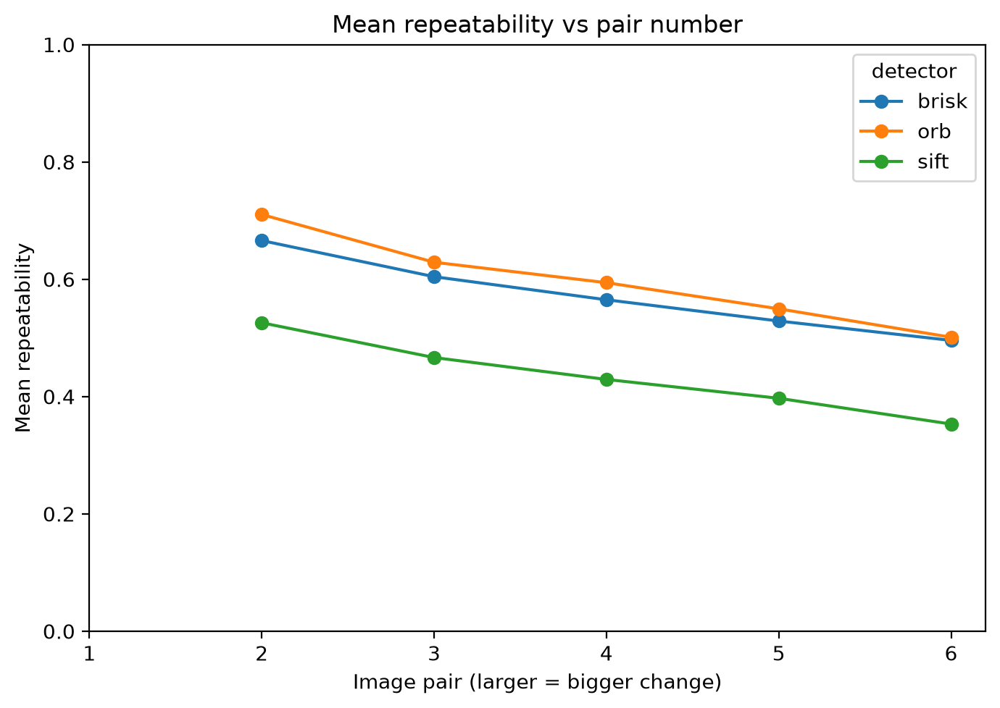

As the image pair increases (larger image pair means a more extreme transformation), all three detectors performed worse and had a lower repeatability. ORB still demonstrates the highest average repeatability for each image pair (between 60%-75%), with BRISK exhibiting similar but slightly poorer performance (between 60-70%). SIFT is much worse, hovering around the 50% repeatability range.

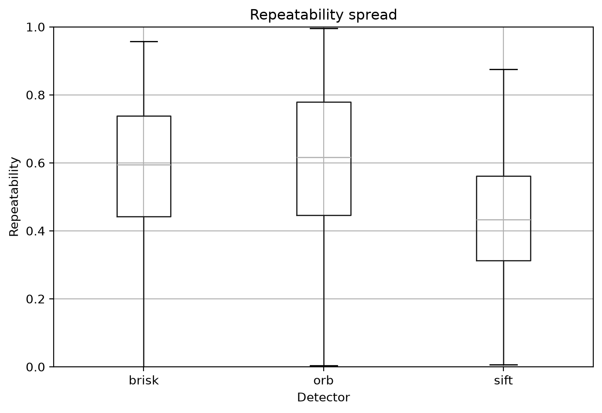

ORB has the highest average repeatability, and also the widest range. SIFT has the smallest range, but also doesn't near 100% repeatability. BRISK has an average repeatability near 60%, and also has a decently large range from 0 to roughly 97%.

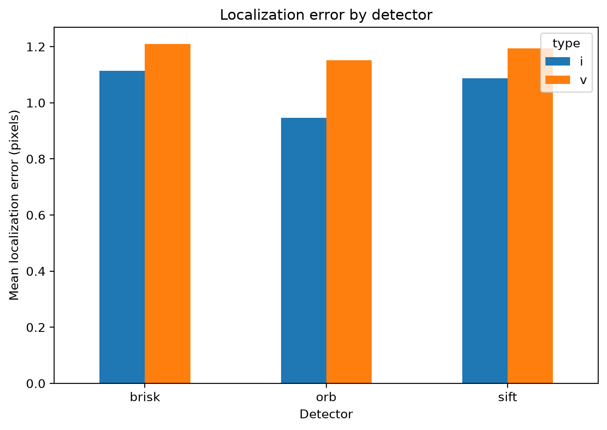

The localization error for ORB is the lowest for both viewpoint and illumination changes. All three detectors have similar localization errors for viewpoint changes, around 1.2 pixels. However, ORB had a noticeably lower localization error for illumination changes (around 0.88) whereas SIFT and BRISK had errors closer to 1.1 pixels.

### Matching
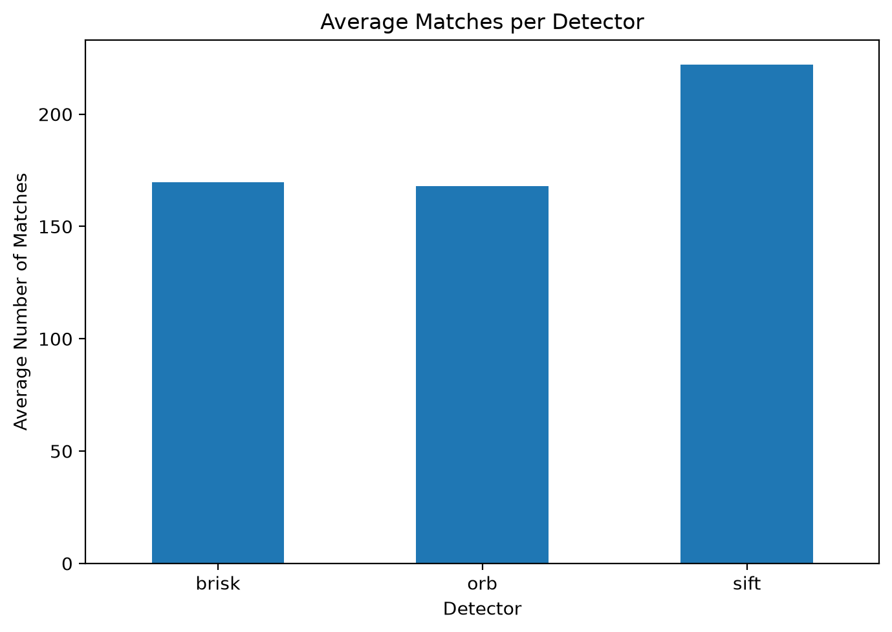

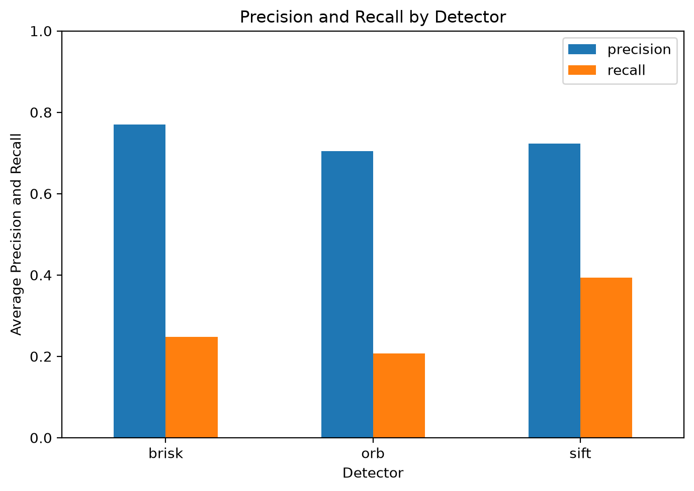
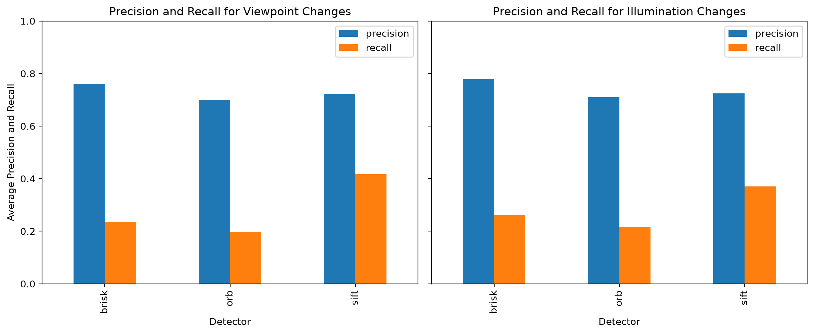

### Speed and Tradeoff
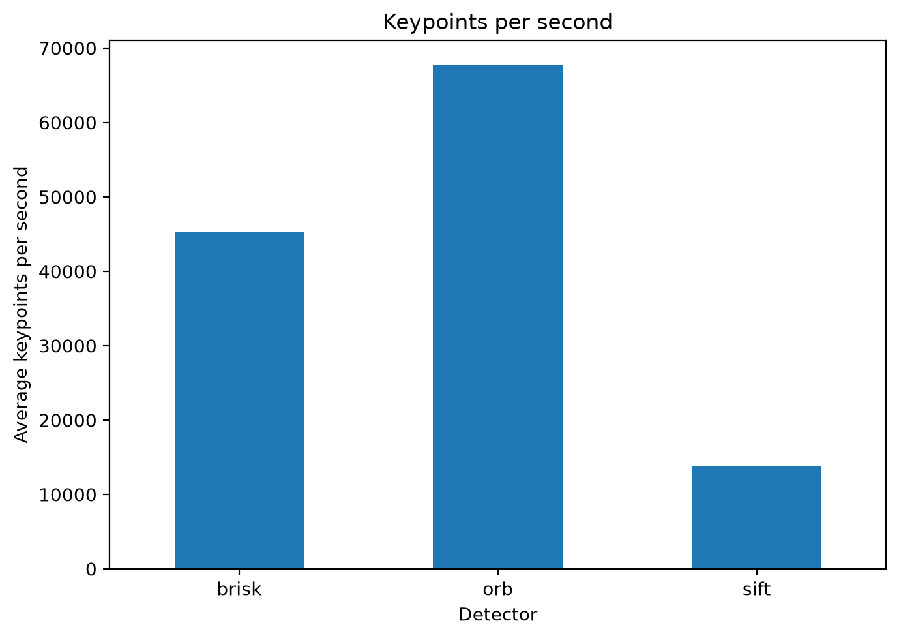
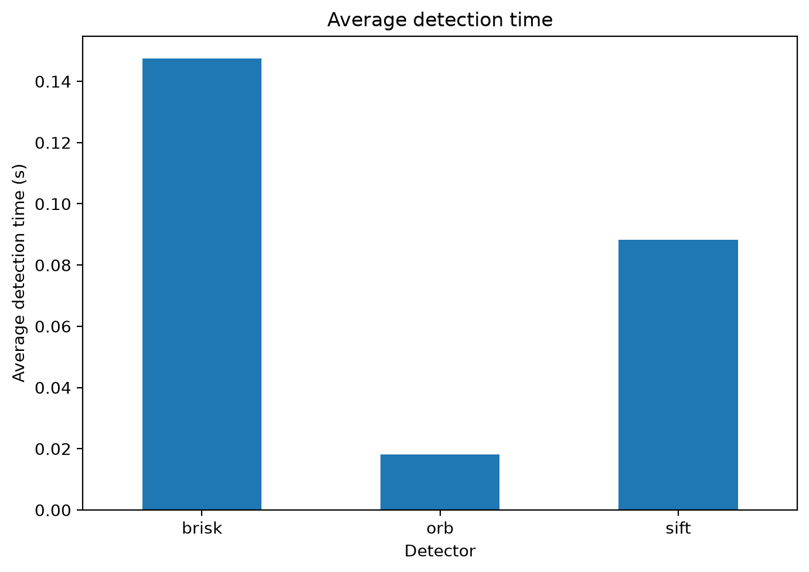
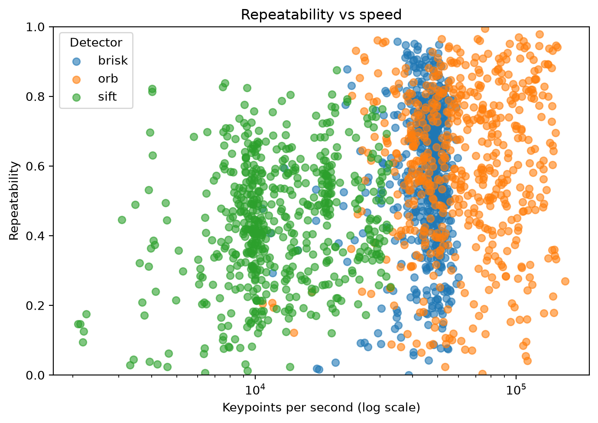

## For the Future
Compare Against: ALGD-ORB
- Trying Adaptive Threshold and Local Gray Difference-ORB (ALGD-ORB)

Compare Against: Personally Created Feature Detector

Measure More Metrics:
- Keypoint Distribution
- Test With Actual Visual Odometry
- Different Thresholds

# Sources
- credit to https://github.com/hpatches/hpatches-dataset/tree/master for sequence images